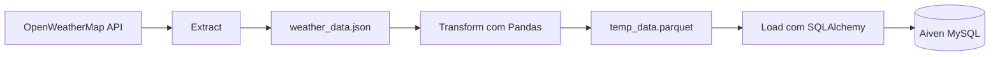

# ETL de Dados Meteorológicos

Pipeline de dados que consulta as condições meteorológicas de São Paulo na
OpenWeatherMap, transforma a resposta com Pandas e carrega o resultado em um
banco MySQL hospedado no Aiven.

O projeto pode ser executado diretamente com Python ou de forma orquestrada
pelo Apache Airflow em containers Docker.

## Fluxo do projeto



### 1. Extract

O arquivo `extract_data.py` realiza uma requisição à OpenWeatherMap e salva a
resposta bruta em:

```text
data/weather_data.json
```

### 2. Transform

O arquivo `transform_data.py`:

- converte o JSON em um DataFrame;
- normaliza os dados de clima;
- remove colunas desnecessárias;
- renomeia as colunas;
- converte os campos de data e hora para `America/Sao_Paulo`.

Quando executado pelo Airflow, o resultado temporário é salvo em:

```text
data/temp_data.parquet
```

### 3. Load

O arquivo `load_data.py` cria uma conexão TLS com o Aiven MySQL utilizando
SQLAlchemy e PyMySQL. Os dados são inseridos na tabela:

```text
sp_weather
```

Se a tabela ainda não existir, o Pandas cria sua estrutura automaticamente.
As próximas execuções adicionam novas linhas com `if_exists="append"`.

## Tecnologias utilizadas

- Python 3.13
- Pandas
- Requests
- SQLAlchemy
- PyMySQL
- OpenWeatherMap API
- Aiven for MySQL
- Apache Airflow 3.1.7
- Docker e Docker Compose
- uv

## Estrutura de diretórios

```text
ETL-Dados-Meteorologicos/
├── config/
│   └── .env
├── dags/
│   └── weather_dag.py
├── data/
│   ├── weather_data.json
│   └── temp_data.parquet
├── notebooks/
│   └── analysis_data.ipynb
├── src/
│   ├── main.py
│   └── etl_dados_meteorologicos/
│       ├── extract_data.py
│       ├── transform_data.py
│       └── load_data.py
├── docker-compose.yaml
├── pyproject.toml
└── README.md
```

## Pré-requisitos

Antes de começar, instale:

- Python 3.13;
- [uv](https://docs.astral.sh/uv/);
- Docker Desktop com Docker Compose;
- uma conta e uma chave na OpenWeatherMap;
- um serviço MySQL no Aiven.

## Configuração do projeto

### 1. Clone o repositório

```bash
git clone <URL_DO_REPOSITORIO>
cd ETL-Dados-Meteorologicos
```

### 2. Instale as dependências

```bash
uv sync
```

O comando cria ou atualiza a `.venv` usando as dependências declaradas no
`pyproject.toml`.

### 3. Configure as variáveis de ambiente

Crie o arquivo `config/.env`:

```dotenv
API_KEY=sua_chave_openweathermap

DB_HOST=seu-host-mysql.aivencloud.com
DB_PORT=12345
DB_NAME=defaultdb
DB_USER=avnadmin
DB_PASSWORD=sua_senha
DB_SSLMODE=require
```

Os dados de conexão estão disponíveis no painel do Aiven em **Quick connect**.

> Nunca envie o arquivo `config/.env` para o Git. Ele está listado no
> `.gitignore` porque contém credenciais.

## Execução local

Para executar as três etapas sem o Airflow:

```bash
uv run src/main.py
```

O processo esperado é:

```text
ETAPA 1: EXTRACT
ETAPA 2: TRANSFORM
ETAPA 3: LOAD
Pipeline concluído com sucesso!
```

## Execução com Airflow e Docker

### 1. Inicialize o Airflow

Este comando é necessário na primeira execução ou após remover os volumes:

```bash
docker compose up airflow-init
```

A inicialização cria o banco de metadados e o usuário administrador do Airflow.

### 2. Inicie os serviços

```bash
docker compose up -d
```

Confira o estado dos containers:

```bash
docker compose ps
```

Quando os serviços estiverem saudáveis, acesse:

```text
http://localhost:8080
```

Credenciais locais padrão:

```text
Usuário: airflow
Senha: airflow
```

### 3. Execute o DAG

Na interface do Airflow:

1. Localize o DAG `weather_pipeline`.
2. Ative o DAG no botão de pausa/execução.
3. Use **Trigger DAG** para realizar um teste manual.
4. Acompanhe `extract`, `transform` e `load` pela visualização do DAG.

O DAG está configurado para executar no início de cada hora:

```text
0 * * * *
```

Em caso de falha, cada tarefa possui duas novas tentativas, com intervalo de
cinco minutos.

## Comandos úteis do Docker

Visualizar logs em tempo real:

```bash
docker compose logs -f
```

Visualizar apenas os logs do scheduler:

```bash
docker compose logs -f airflow-scheduler
```

Parar e remover os containers, preservando os volumes:

```bash
docker compose down
```

Reiniciar os serviços:

```bash
docker compose restart
```

> `docker compose down -v` também remove os volumes e apaga o banco de
> metadados local do Airflow. Use essa opção somente quando desejar reiniciar o
> ambiente do zero.

## Solução de problemas

### `docker` não é reconhecido

Feche e abra novamente o terminal ou o VS Code depois de instalar ou mover o
Docker. Confirme a instalação com:

```bash
docker --version
docker compose version
```

### Erro de importação do DAG

Confira se o Compose contém os volumes:

```yaml
- ./dags:/opt/airflow/dags
- ./src:/opt/airflow/src
- ./data:/opt/airflow/data
- ./config:/opt/airflow/config
```

Para listar erros de importação:

```bash
docker compose exec airflow-scheduler airflow dags list-import-errors
```

### Verificar a conexão com o Aiven

Confirme se `DB_HOST`, `DB_PORT`, `DB_NAME`, `DB_USER` e `DB_PASSWORD` possuem
os valores exibidos pelo Aiven. Um erro MySQL `1045 Access denied` normalmente
indica usuário ou senha incorretos.

## Observações

- O `docker-compose.yaml` é voltado ao desenvolvimento local.
- As credenciais padrão do Airflow devem ser alteradas em ambientes reais.
- Execuções repetidas adicionam novas linhas à tabela `sp_weather`.
- O projeto utiliza arquivos compartilhados entre as tarefas do Airflow; por
  isso, os volumes `data/` e `src/` devem permanecer montados.
